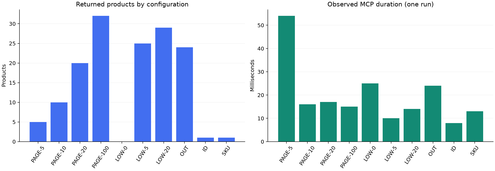
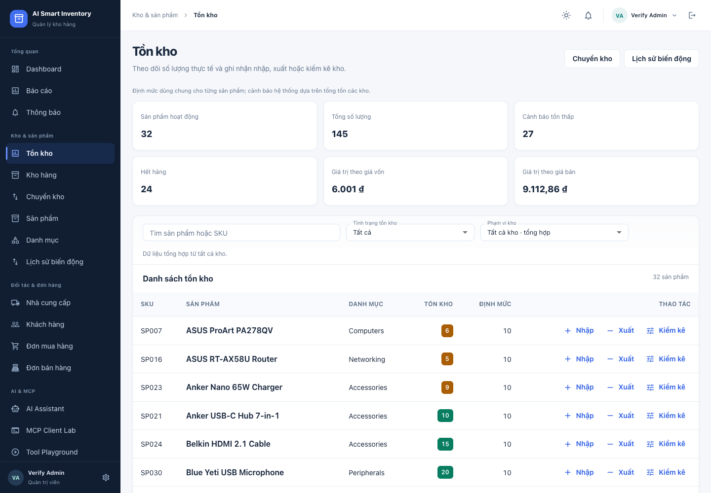
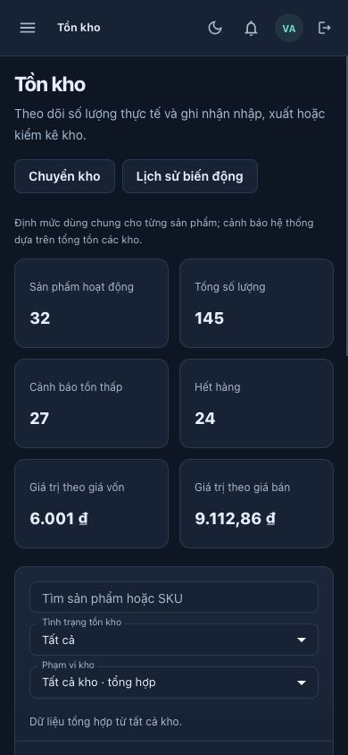

# Báo cáo thực nghiệm và hoàn thiện giao diện

Thời điểm quan sát: **21/11/2026 04:51:09 UTC+7**. Kết quả toàn suite: **PASS** (`verification.json: passed = true`).

## 1. Tình huống và môi trường

Chạy trên .NET 10, PostgreSQL, API ASP.NET Core và MCP Client/Server C# thật. Harness tạo DB `test_inventory_<uuid>`, migrate, seed 32 sản phẩm/5 danh mục và ba tài khoản Admin/Staff/Customer riêng. Sau chạy, process API/MCP và đúng DB tạm được dọn; không reset database development.

Bộ kiểm chứng thực hiện **43 lời gọi HTTP có mong đợi cụ thể**, kèm assertion về output, tổng số, số dư và movement. Có **10 cấu hình đọc MCP**. Đây không phải tuyên bố bao phủ mọi ca nghiệp vụ.

## 2. Các bộ tham số và kết quả so sánh

Trước nhóm đọc, tạo 8 phiếu nhập có lượng 2, 5, 9, 10, 15, 20, 30, 50; tổng tồn **141**, còn **24** sản phẩm bằng 0. Sản phẩm thử theo ID/SKU có tồn 2 ở giai đoạn này.

| Ca | Arguments | Trả về | Tổng khớp | Thời gian MCP (ms) | Trạng thái |
| --- | --- | ---: | ---: | ---: | --- |
| PAGE-5 | `{"page": 1, "pageSize": 5}` | 5 | 32 | 54 | Succeeded |
| PAGE-10 | `{"page": 1, "pageSize": 10}` | 10 | 32 | 16 | Succeeded |
| PAGE-20 | `{"page": 1, "pageSize": 20}` | 20 | 32 | 17 | Succeeded |
| PAGE-100 | `{"page": 1, "pageSize": 100}` | 32 | 32 | 15 | Succeeded |
| LOW-0 | `{"threshold": 0, "page": 1, "pageSize": 100}` | 0 | 0 | 25 | Succeeded |
| LOW-5 | `{"threshold": 5, "page": 1, "pageSize": 100}` | 25 | 25 | 10 | Succeeded |
| LOW-20 | `{"threshold": 20, "page": 1, "pageSize": 100}` | 29 | 29 | 14 | Succeeded |
| OUT | `{"page": 1, "pageSize": 100}` | 24 | 24 | 24 | Succeeded |
| ID | `{"id": 7}` | 1 | 1 | 8 | Succeeded |
| SKU | `{"sku": "SP007"}` | 1 | 1 | 13 | Succeeded |

**Nhận xét:** pageSize thay đổi số dòng của trang, không thay đổi tổng 32 sản phẩm. threshold dùng điều kiện nhỏ hơn nghiêm ngặt: threshold = 0 không có sản phẩm, threshold = 5 gồm các sản phẩm tồn 0 và sản phẩm tồn 2. ID và SKU xác định cùng sản phẩm. Thời gian chỉ là một lượt quan sát có ảnh hưởng khởi tạo kết nối/cache, chưa đủ kết luận cấu hình nào nhanh nhất.

## 3. Ghi dữ liệu, xác nhận và rollback

| Tình huống | Mong đợi | Quan sát |
| --- | --- | --- |
| Prepare receipt +7 | Chưa đổi tồn | Tồn vẫn 2. |
| Confirm | Tăng tồn đúng một lần | Tồn 2 → 9; intent Succeeded. |
| Confirm lại | Không nhập thêm | Tồn vẫn 9. |
| Issue 3 | Giảm đúng 3 | Tồn 9 → 6. |
| Issue 9999 | Từ chối, không đổi tồn | HTTP 409, tồn cuối vẫn 6. |
| Cancel receipt +4 | Không thực thi | Tồn vẫn 6. |
| Đối chiếu SQL cuối | 10 movements, tổng tồn 145 | Assertion PostgreSQL đạt. |

Tổng tồn cuối **145 = 141 + 7 − 3**. Snapshot notebook và câu trả lời LLM lấy ở giai đoạn sau ghi, vì vậy có thể khác nhóm đọc ở trên. Không trộn hai thời điểm khi so sánh ngưỡng.

## 4. Phân quyền

| API | Chưa đăng nhập | Customer | Staff | Admin |
| --- | --- | --- | --- | --- |
| GET products | 401 | 403 | 200 | 200 |
| GET users | Không kiểm tra trong lượt này | 403 | 403 | 200 |
| GET mcp/tools | Không kiểm tra trong lượt này | 403 | 200 | 200 |

Browser kiểm tra thêm đường dẫn users/audit/inventory/mcp-lab cho Staff và Customer: Staff bị chuyển khỏi users/audit, Customer chuyển về profile. Backend vẫn là lớp quyết định quyền; router và menu hỗ trợ trải nghiệm.

## 5. Notebook và LLM thật

[Notebook đã thực thi](../MCP_CSharp_Inventory_Experiments.ipynb) hiện có 11 ô mã đã chạy, không có error output và có hai biểu đồ PNG nhúng. Nó đọc SQL thật, gọi MCP C# thật, đối chiếu toàn bộ trang/ID/số tồn và xuất snapshot/CSV/log. [CSV kết quả notebook](../results/notebook-real_experiment_results.csv) được giữ cùng báo cáo.

Provider: **OpenAICompatible**, model **openai/gpt-oss-20b**. Đã được người dùng chấp thuận gửi output dữ liệu mẫu cho phép thử này. LLM chọn **GetInventorySummary**, tool trả Succeeded, câu trả lời có **32 sản phẩm, tổng tồn 145 và 24 sản phẩm hết hàng**. Trace và execution ID nằm trong [log đầy đủ](../results/verification.json).

Đây là một câu hỏi tổng hợp đã xác minh. Chưa đánh giá độ chính xác ngôn ngữ tự nhiên trên nhiều cách hỏi, nhiều lượt hội thoại hoặc yêu cầu ghi qua AI.

## 6. Giao diện và bố cục

Đã cải thiện typography theme, vùng heading/actions, ngắt dòng lỗi/dialog, cuộn bảng bằng bàn phím, giữ phân trang khi trang rỗng và guard route Admin/Staff. Giữ thư viện Material UI, API và nghiệp vụ hiện tại.

QA Chrome local đạt **50 lượt**: 21 route ở desktop 1440×1000/light và mobile 390×844/dark, cộng 8 kiểm tra route theo vai trò. Không có runtime exception, không có tràn ngang cấp trang, không ghi nhận alert lỗi tải API trong các trang quan sát.

Các ảnh là trạng thái sau thay đổi. Đợt này không có ảnh trước thay đổi; đối chiếu hành vi trước/sau qua diff. Chưa đo thời gian thao tác người dùng hoặc chứng nhận accessibility đầy đủ.

## 7. Cải tiến và giới hạn

- Bằng chứng được tập trung trong repo, có input/output, thời gian, execution IDs và hướng dẫn chạy lại.
- Phân quyền được kiểm tra ở cả HTTP và chuyển hướng giao diện; không chỉ dựa vào ẩn menu.
- Dữ liệu thử được cô lập trong DB tạm; không cần thay mật khẩu hay quyền tài khoản thật.
- Notebook giữ output thật; không coi mô phỏng CSV là thực thi MCP.
- QA trình duyệt dùng hạn mức request riêng cho process test để tránh đụng giới hạn khi mở nhiều trang; chưa kiểm chứng tải/rate limiting production.
- Chưa kiểm tra mọi biến thể ghi, nhiều kho, mọi trình duyệt/kích thước, mất mạng giữa giao dịch hoặc deployment production.

## 8. Tái hiện

Xem [Verification README](../Verification/README.md). Build solution, build bộ Verification, rồi bật `INVENTORY_BROWSER_QA=1` và `INVENTORY_NOTEBOOK_QA=1` nếu đủ môi trường. Chế độ `INVENTORY_LIVE_LLM=1` cần chấp thuận gửi output mẫu tới provider đã cấu hình.

Nguồn đối chiếu: [HTTP CSV](../results/http-comparison.csv), [tham số MCP](../results/parameter-comparison.csv), [JSON toàn suite](../results/verification.json), [browser JSON](../results/browser/browser-results.json), [snapshot SQL notebook](../results/notebook-real_inventory_snapshot.csv).

## 9. Bổ sung Training/Validation/Test cho yêu cầu học phần

Đã thêm mô hình phụ chọn read tool MCP bằng C#, dataset 160 câu mẫu, 10 cấu hình và log Training/Test thật. Xem [báo cáo Training/Test](TRAINING-TEST-REPORT.md) để biết run-id, bảng tham số, kết quả, các câu phân loại sai, biểu đồ và trace dự đoán gọi MCP. Các mục 1–8 phía trên giữ kết quả đợt MCP/LLM gốc; phần Training bổ sung có dataset, thời điểm và log riêng, không phải fine-tuning LLM.
