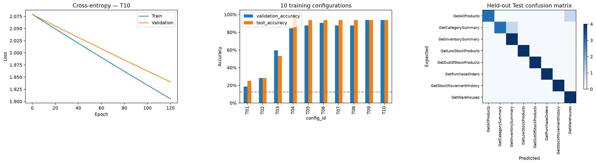

# Training và Test — Mô hình chọn read tool MCP bằng C#

Run ID: **20261121T1206152520820Z**. Đây là lượt thực thi C# và notebook thật, không phải log mô phỏng. Mô hình bổ sung phân loại câu hỏi thành tên tool đọc; chưa tích hợp vào AI Assistant production và không phải fine-tuning LLM.

## 1. Tình huống chạy thử

Thử thay số epoch, learning rate, regularization L2 và unigram/bigram để quan sát loss, accuracy và macro-F1 khi chọn tool MCP. Sau khi chọn cấu hình bằng Validation, kiểm tra trên Test độc lập theo các câu đã tách; tiếp tục gửi tám dự đoán cố định qua API → MCP Client/Server C# → PostgreSQL thật.

## 2. Dataset và cách chia

- [mcp_tool_intents.csv](../data/mcp_tool_intents.csv): 160 câu hỏi tiếng Việt mẫu do trợ lý biên soạn cho bài, gán nhãn 8 read tool; chưa phải hội thoại người dùng thật.
- Train **96**, Validation **32**, Test **32**; mỗi lớp lần lượt 12/4/4 câu. ID và câu chuẩn hóa không trùng.
- Chỉ cột text tạo features; intent là nhãn. Từ vựng và IDF chỉ fit trên Train.
- Snapshot 32 sản phẩm PostgreSQL phục vụ phần MCP/SQL của notebook, không dùng làm lịch sử bán hàng hoặc dataset dự báo nhu cầu.
- SHA-256 dataset: `E9F23126D7BB229CCC63C9C28A8F0A96A2E53A59691B019A44D23221A34F9BAD`. [Manifest split và nguồn dữ liệu](../results/training/20261121T1206152520820Z/dataset_manifest.json).

## 3. Mô hình và các bộ tham số

C# triển khai TF-IDF + softmax regression đa lớp, cập nhật trọng số bằng full-batch gradient descent và L2. Loss báo cáo là cross-entropy dữ liệu. Cả 10 cấu hình dùng seed 42. File [training_configurations.json](../data/training_configurations.json) là đầu vào trực tiếp của chương trình.

| Cấu hình | Epoch | Learning rate | L2 | N-gram | Train loss | Train accuracy | Validation F1 | Test accuracy | Test F1 | Chọn bằng Validation |
| --- | ---: | ---: | ---: | ---: | ---: | ---: | ---: | ---: | ---: | --- |
| T01 | 1 | 0.001 | 0 | 1 | 2.0785 | 20.83% | 0.1714 | 25.00% | 0.2045 |  |
| T02 | 5 | 0.01 | 0.0001 | 1 | 2.0775 | 22.92% | 0.2562 | 28.12% | 0.2250 |  |
| T03 | 15 | 0.03 | 0.0001 | 1 | 2.0698 | 61.46% | 0.5830 | 53.12% | 0.4717 |  |
| T04 | 40 | 0.05 | 0.0001 | 1 | 2.0399 | 96.88% | 0.8428 | 100.00% | 1.0000 |  |
| T05 | 80 | 0.1 | 0.0001 | 1 | 1.9278 | 98.96% | 0.8763 | 93.75% | 0.9365 |  |
| T06 | 80 | 0.2 | 0.001 | 1 | 1.7891 | 100.00% | 0.9048 | 93.75% | 0.9365 |  |
| T07 | 80 | 0.1 | 0.01 | 1 | 1.9335 | 98.96% | 0.8763 | 93.75% | 0.9365 |  |
| T08 | 80 | 0.1 | 0.1 | 1 | 1.9741 | 98.96% | 0.8763 | 93.75% | 0.9365 |  |
| T09 | 80 | 0.1 | 0.001 | 2 | 1.9618 | 100.00% | 0.9365 | 93.75% | 0.9365 |  |
| T10 | 120 | 0.1 | 0.001 | 2 | 1.9053 | 100.00% | 0.9365 | 93.75% | 0.9365 | Có |

Cấu hình **T10** được khóa trước khi đánh giá Test theo Validation macro-F1 rồi Validation loss. Test accuracy **93.75%**, macro-F1 **0.9365**; baseline luôn chọn một lớp đạt **12.50%**. Không chọn lại T04 chỉ vì lượt Test của nó đạt 100%.

## 4. Log Training và Test

| Artifact | Nội dung thực tế |
| --- | --- |
| [Training CSV](../results/training/20261121T1206152520820Z/training_log.csv) / [Training JSONL](../results/training/20261121T1206152520820Z/training_log.jsonl) | **591** bản ghi, gồm epoch 0 của mỗi cấu hình; train/validation loss, accuracy/F1 và thời gian quan sát. |
| [Test JSONL](../results/training/20261121T1206152520820Z/test_log.jsonl) | 10 sự kiện Test sau khi khóa lựa chọn; mỗi sự kiện có sampleCount = 32, loss, accuracy, macro-F1 và confusion matrix. |
| [Dự đoán từng mẫu](../results/training/20261121T1206152520820Z/test_predictions.csv) | 320 dự đoán: 32 Test × 10 cấu hình; nhãn mong đợi, dự đoán, softmax score và đúng/sai. |
| [Bảng so sánh](../results/training/20261121T1206152520820Z/experiment_results.csv) | Tham số và các kết quả Train/Validation/Test của 10 cấu hình. |
| [Lựa chọn](../results/training/20261121T1206152520820Z/selection.json) / [model](../results/training/20261121T1206152520820Z/selected_model.json) | Tiêu chí không dùng Test, model TF-IDF/trọng số/bias và hash dataset. |
| [Kết quả kiểm tra pipeline](../results/training/20261121T1206152520820Z/summary.json) | Loss Train giảm, xác suất hợp lệ, chia dữ liệu hợp lệ và lưu/nạp model giữ nguyên dự đoán. |



## 5. Test dự đoán qua MCP thật

Chọn câu Test đầu tiên theo thứ tự CSV của mỗi nhãn, không chọn theo dự đoán đúng. Cả **8** tool call thực thi thành công; **8/8** câu chọn đúng intent trong tập con tích hợp này. Tool dùng arguments mặc định và backend vẫn kiểm tra quyền.

[Bảng tích hợp MCP](../results/training/20261121T1206152520820Z/routing_mcp_results.csv) và [log MCP từng dự đoán](../results/training/20261121T1206152520820Z/routing_mcp_test_log.jsonl) có tên tool mong đợi/dự đoán, execution ID, status, duration và output thực tế. Tập con 8 câu kiểm tra kết nối không thay thế kết quả Test 32 câu ở trên.

## 6. Nhận xét

- Các cấu hình ít epoch/learning rate nhỏ còn thiếu huấn luyện, thể hiện bằng loss cao và accuracy thấp. Thêm epoch và thay learning rate giúp cải thiện trên dataset này.
- Unigram/bigram và L2 làm kết quả Validation thay đổi. Không kết luận một tham số luôn tốt hơn từ một dataset nhỏ.
- Cấu hình chọn bằng Validation vẫn sai 2 câu Test dù Train đạt 100%; cần giữ nguyên các lỗi này trong báo cáo.

| ID Test | Câu hỏi | Tool đúng | Tool dự đoán |
| --- | --- | --- | --- |
| I01-20 | Hiển thị bảng mặt hàng của hệ thống | GetAllProducts | GetWarehouses |
| I06-20 | Xem tổng quan tồn của các nhóm sản phẩm | GetCategorySummary | GetInventorySummary |

- Loss còn giảm ở cuối lượt được quan sát; chưa thể kết luận đã hội tụ hoàn toàn.
- Dataset được biên soạn trong cùng miền từ vựng, Test chỉ 32 câu; một lỗi đổi accuracy 3,125 điểm phần trăm. Kết quả không chứng minh chất lượng production hoặc vượt LLM.

## 7. Cải tiến tiếp theo

Thu thập câu hỏi người dùng đã được cho phép, gán nhãn độc lập, tăng kích thước Test, kiểm tra cách diễn đạt ngoài miền và lớp từ chối khi không đủ thông tin. Đánh giá trích xuất arguments riêng, calibration và quyền truy cập. Không tự dùng mô hình này để thực thi write tool.

## 8. Tái hiện

Xem [Training README](../Training/README.md). Từ thư mục gốc dự án, chạy `dotnet run --project experiments/Training` không cần DB/provider. Các lệnh sau dành cho **thư mục gốc source ứng dụng AI-Smart-Inventory** để chạy và lưu toàn bộ notebook mới:

```sh
dotnet build AI-Smart-Inventory.slnx --disable-build-servers
INVENTORY_NOTEBOOK_QA=1 dotnet run --project experiments/Verification --no-build
```

[Notebook](../MCP_CSharp_Inventory_Experiments.ipynb) đã thực thi **11/11 ô mã**, không có error output, có **2 biểu đồ PNG nhúng**. Runner dùng DB test riêng và đã dọn DB đó; không dùng số liệu test thay cho kho development.

Output Phần B cùng notebook hiện tại: [tham số/kết quả](../results/notebook/20261121T120616009173Z/real_experiment_results.csv), [snapshot SQL](../results/notebook/20261121T120616009173Z/real_inventory_snapshot.csv) và [execution log](../results/notebook/20261121T120616009173Z/real_execution_log.json). Các file `results/notebook-real_*` ở cấp trên thuộc đợt báo cáo MCP/LLM cũ.
